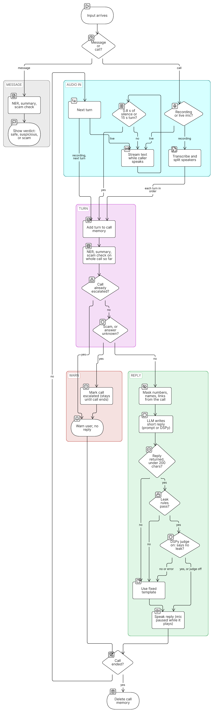

<h1 align="center">Callas</h1>
<p align="center"><i>A guard for Thai scam calls and messages</i></p>

<div align="center">
  
  
  <br>
  
  
  
  
  
  
  
  
</div>

<br>

Callas checks Thai phone calls and text messages for scams. It turns a call into text, splits it by speaker, and checks every turn. If the call looks normal, Callas can answer with a short, safe voice reply. If the call looks like a scam, Callas stops and warns the user.

Callas works in Thai only. It does not connect to LINE, Messenger, Instagram or a real phone line. You use it through a web demo.

> **Status:** the full pipeline and the web demo work. The scam check and summary use the LLM for now. The team will replace them with fine-tuned WangchanBERTa models. The full design is in [`docs/spec.html`](docs/spec.html).

## Contents

- [What it does](#what-it-does)
- [Quick start](#quick-start)
- [How it works](#how-it-works)
- [Project layout](#project-layout)
- [Settings](#settings)
- [How to contribute](#how-to-contribute)
- [Safety rules](#safety-rules)
- [What we measure](#what-we-measure)
- [Open items](#open-items)

## What it does

- **Speech to text.** Turns Thai call audio into text and splits it into speaker A and speaker B.
- **Live calls.** Listens to the microphone and shows the text while the caller speaks.
- **Entities.** Finds phone numbers, bank accounts, OTP codes, links, money amounts and names.
- **Summary.** Writes a short note about the call or message.
- **Scam check.** Says if it is a scam. If yes, it picks one of 5 types: fake authority / call center, romance, investment, phishing / OTP, or lottery / prize.
- **Call memory.** Remembers every turn of the call. Many scams start as normal calls, so Callas checks each new turn together with the turns before it.
- **Voice reply.** For a normal call, an LLM writes a short Thai reply and the computer speaks it. A leak check blocks any reply that repeats a number, name or link from the call.
- **Web demo.** Three pages: check a message, simulate a call from a recording, and a live call with your microphone.

## Quick start

You need Python 3.10 or newer. The scam check, summary and reply need an LLM served with vLLM on a machine you control.

```bash
# 1. Install (pick the extras you need)
python -m venv .venv
.venv/Scripts/activate            # Windows. On macOS or Linux: source .venv/bin/activate
pip install -e ".[asr,tts,dev]"   # add ,dspy for the DSPy reply writer

# 2. Settings
cp .env.example .env              # then fill in VLLM_BASE_URL and VLLM_MODEL

# 3. Check the LLM server
python -m llm_serving.health

# 4. Run the web demo
uvicorn backend.main:app --port 8077
```

Open http://localhost:8077.

**Demo mode, without models or GPU:** set `CALLAS_FAKE=1` before step 4. Every page then runs on a scripted call and fake models. This is the fastest way to work on the UI.

```bash
CALLAS_FAKE=1 uvicorn backend.main:app --port 8077
```

The first real run downloads the speech models (Typhoon ASR and Nemotron diarization, about 100 MB each) into `~/pythaiasr-data`. After that they work offline.

## How it works

```text
Call audio ──► speech to text ──► speaker split ──► call memory ──► nlp-core ──► decide()
Live mic   ──► streaming text, a turn ends after 0.8 s of silence ─┘               ├─ scam   ──► warn the user
                                                                                   └─ normal ──► masked context ──► LLM reply ──► leak check ──► voice
Text message ──► nlp-core ──► verdict
```

The LLM never decides whether to warn or reply. Fixed rules in `decide()` do that.

### System architecture


### Decision flow



### LangGraph pipeline

Each call turn runs through a LangGraph graph: `remember → analyze → decide → reply → speak`, or `decide → escalate`. A text message runs `analyze → verdict`. The code is in [`modules/orchestrator/graph.py`](modules/orchestrator/graph.py). The drawing is in [`docs/diagrams/langgraph.md`](docs/diagrams/langgraph.md). To draw it again after you change the graph:

```bash
python -m orchestrator.show_graph --out docs/diagrams/langgraph.md
```

### Live call, turn by turn


### Data schema

Blue tables are stored on disk. Purple tables live in memory during a call. Yellow is one eval result file.


The diagrams are made in [Eraser](https://app.eraser.io/workspace/15jDoAO4Rlj2bQ5kTYqg). Their sources are in `docs/diagrams/*.eraser`. Edit them in Eraser, then export a new PNG into `docs/diagrams/`.

## Project layout

```text
modules/
  asr_diarization/   speech to text (Typhoon ASR) and speaker split (Nemotron-3), file and live
  nlp_core/          entities, summary, scam check; slots where WangchanBERTa plugs in
  llm_serving/       LLM client for vLLM, prompts, DSPy reply writer and leak judge
  tts_voice_agent/   call memory, decide(), leak check, reply templates, voice (PyThaiTTS)
  orchestrator/      LangGraph graphs, call sessions, live calls, the explaining agent
  callas_settings.py reads .env
backend/             FastAPI web demo: Jinja templates, HTMX, Tailwind, live call over WebSocket
docs/                spec, diagrams, Figma exports
```

Each module has a `tests/` folder. More detail:

- [`modules/orchestrator/README.md`](modules/orchestrator/README.md): the graphs, where the safety rules live, DSPy, how to add your WangchanBERTa model, live calls.
- [`backend/README.md`](backend/README.md): the web pages, demo mode, how to rebuild the CSS.

Planned but not started: `data_pipeline/` (dataset), `eval/` (scores for the report).

## Settings

All settings come from `.env` (copy `.env.example`). Never commit `.env`.

| Setting | Default | What it does |
|---|---|---|
| `VLLM_BASE_URL` | `http://localhost:8000/v1` | Your vLLM server |
| `VLLM_MODEL` | empty | Model name. Empty means the first model the server lists |
| `VLLM_API_KEY` | `EMPTY` | Key for the vLLM server, if it needs one |
| `VLLM_TIMEOUT_S` | `30` | Seconds before an LLM call gives up |
| `ASR_MODEL` | `typhoon_asr` | Speech-to-text model (pythaiasr) |
| `DIARIZER` | `nemotron` | Speaker split: `nemotron` or `pyannote_segmentation` |
| `TTS_PRETRAINED` | `fastthaig2p` | Voice engine (PyThaiTTS) |
| `TTS_SPEAKER` | `thai_som` | Voice |
| `REPLY_ENGINE` | `prompt` | How the reply is written: `prompt` or `dspy` |
| `LEAK_JUDGE` | `off` | `on` adds a DSPy leak judge after the leak rules. It can only block more replies, never fewer |
| `NLP_NER`, `NLP_CLASSIFIER`, `NLP_SUMMARIZER` | `rules`, `llm`, `llm` | Which model fills each nlp-core slot |
| `CALLAS_FAKE` | not set | `1` runs the web demo with fake models |

The explaining agent on the message page needs vLLM started with `--enable-auto-tool-choice --tool-call-parser <parser for your model>`. Without it the page still works and says the explanation is not available.

## How to contribute

### Where to start

| Task | Where | Notes |
|---|---|---|
| Fine-tune WangchanBERTa for NER, scam check or summary | `modules/nlp_core/` | Follow "Add your WangchanBERTa model" in [`modules/orchestrator/README.md`](modules/orchestrator/README.md). Register your model, then set `NLP_CLASSIFIER=wangchanberta` (or `NLP_NER`, `NLP_SUMMARIZER`). You do not need to change the pipeline |
| Build the dataset | new `modules/data_pipeline/` | See the data-pipeline section in [`docs/spec.html`](docs/spec.html) for the record format and the split |
| Eval scripts and report numbers | new `eval/` | Every number in the report must come from a script run on `test.jsonl` |
| Web UI | `backend/` | Use demo mode (`CALLAS_FAKE=1`). The design is in Figma and `docs/design/` |

### Before you open a pull request

```bash
pytest -q                 # all tests must pass
ruff check .              # lint
ruff format modules backend
```

- Work on a branch, not on `main`. Open a pull request and link the issue.
- Add a test for every new rule or bug fix. Check that the test fails when you break the code it protects.
- Keep `backend/` endpoints thin. Model code belongs in `modules/`.
- Do not commit `.env`, API keys, model files, audio files or data under `data/raw/`.
- The reply prompt (`modules/llm_serving/prompts/reply.v1.txt`) and the reply templates (`modules/tts_voice_agent/templates.py`) need team sign-off before you change them.

## Safety rules

These are tested. Do not remove them.

- Call text stays on our machine. The LLM runs on our own vLLM server, never through an outside API.
- The LLM never decides whether to reply or warn. Fixed rules in `decide()` do that.
- Before the LLM writes a reply, numbers, names and links from the call are masked.
- A reply never repeats a phone number, bank detail, OTP, name, link or anything else from the call. If it does, Callas uses a fixed template instead.
- Once a call is marked as a scam, it stays marked until the call ends.
- Call memory is deleted when the call ends. Uploaded recordings are deleted when the run ends, and at server start and stop.
- The dataset never names a real private person as a scammer or victim.

## What we measure

Every number comes from a script run on the test set and is saved in `eval/results/`.

- Scam check: precision, recall and F1 for each class, for the baseline, WangchanBERTa and the LLM
- Entities: entity-level F1
- Summary: ROUGE-L
- Speech to text: word error rate (WER)
- Speaker split: diarization error rate (DER)
- Call memory: turns until Callas escalates on late-start scam calls, with memory on and off
- Reply safety: how often a reply leaks data from the call (target: never)
- Speed: time for each step, and peak GPU memory (target: under about 15 seconds per input)

## Open items

- Team sign-off on the reply prompt and the reply templates.
- Tune the DSPy reply writer: `python -m llm_serving.dspy_optimize` once `.env` points at vLLM.
- Test the silence threshold for live calls on a real microphone (`VAD_RMS_THRESHOLD` in `modules/asr_diarization/streaming.py`).
- Speaker labels in live calls: pythaiasr has no streaming speaker split yet, so live turns are labelled "Caller".
- The LLM is an open-source model served with vLLM. Which model to use is still open; see the llm-serving section of [`docs/spec.html`](docs/spec.html).
