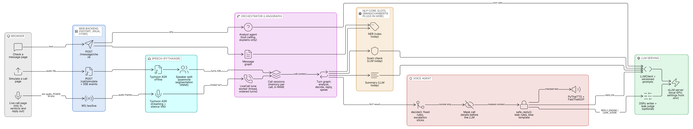
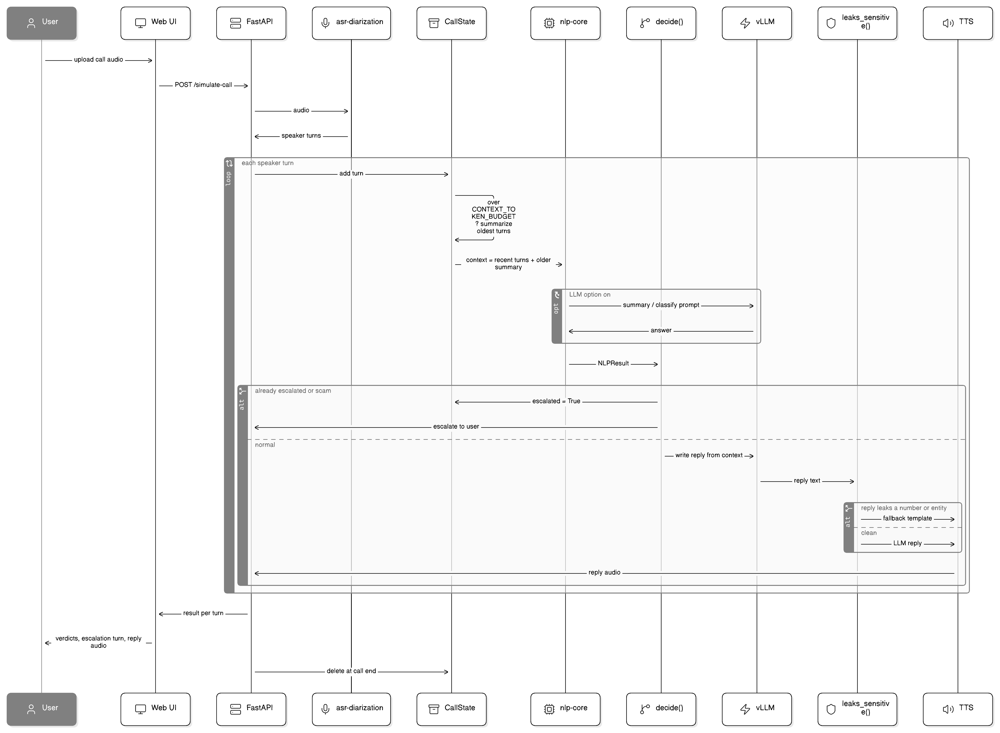
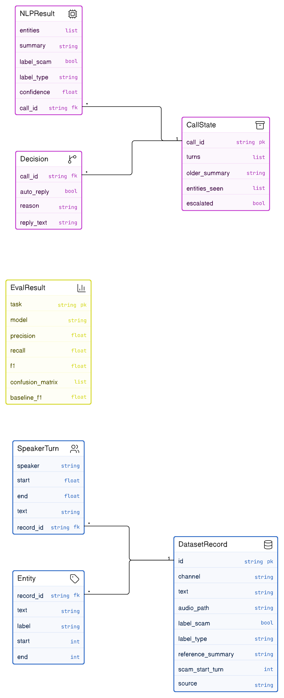

<h1 align="center">Callas</h1>
<p align="center"><i>A guard for Thai scam calls and messages</i></p>

<div align="center">
  
  
  <br>
  
  
  
  
  
  
  
  
</div>

<br>

Callas protects people from Thai phone and message scams. It turns a call into text, works out who said what, and checks each turn for signs of a scam. For a normal call it answers with a short, safe voice reply. For a suspicious call it stops and warns the user.

Callas works in Thai only. It does not connect to LINE, Messenger, Instagram, or a real phone line. Calls and messages go in through a web demo.

> **Status:** planning. The design is written in [`docs/spec.html`](docs/spec.html). No code yet.

## Contents

- [What it does](#what-it-does)
- [How it works](#how-it-works)
- [Modules](#modules)
- [Tech stack](#tech-stack)
- [What we measure](#what-we-measure)
- [Safety rules](#safety-rules)
- [Planned layout](#planned-layout)
- [Open questions](#open-questions)

## What it does

- **Speech to text:** turns Thai call audio into text and splits it by speaker.
- **Named entities:** finds phone numbers, bank details, names, and other key items in the text.
- **Summary:** writes a short note about the call or message.
- **Scam check:** decides if it is a scam. If yes, it picks one of 5 types: fake authority / call center, romance, investment, phishing / OTP, or lottery / prize.
- **Call memory:** remembers every turn of the call. Many scams start as normal calls, and memory lets Callas catch them when the scam starts late.
- **Voice reply:** for normal calls, a local LLM writes a short Thai reply and TTS speaks it. A safety check blocks any reply that repeats a number or detail from the call.
- **Web demo:** upload a call or type a message, then watch each step and see the turn where Callas escalated.

## How it works

```text
Call audio ──► asr-diarization ──► call memory ──► nlp-core ──► decide()
                                                                 ├─ scam   ──► warn the user
                                                                 └─ normal ──► LLM reply ──► safety check ──► TTS

Text message ──► nlp-core ──► verdict
```

### System architecture



### Decision flow

Fixed rules decide whether Callas warns or replies. A reply is written from masked call text, then checked by the leak rules (and the optional DSPy judge) before it is spoken.


### LangGraph pipeline

The per-turn graph and the message graph live in [`modules/orchestrator/graph.py`](modules/orchestrator/graph.py). [`docs/diagrams/langgraph.md`](docs/diagrams/langgraph.md) draws them; regenerate it with `python -m orchestrator.show_graph --out docs/diagrams/langgraph.md`.

### Live call, turn by turn

Each speaker turn goes into call memory, then nlp-core, then `decide()`. Once a call is marked as a scam it stays marked. A normal turn gets an LLM reply, and the reply passes a leak check before TTS speaks it.



### Data schema

Blue tables are stored on disk. Purple tables live in memory during a call. Yellow is one eval result file.



The diagrams are made in [Eraser](https://app.eraser.io/workspace/15jDoAO4Rlj2bQ5kTYqg). Edit them there, then export a new PNG into `docs/diagrams/`.

## Modules

| Module | Job |
|---|---|
| `data-pipeline` | Builds the labeled dataset: generated calls and messages, scraped scam reports, and two Kaggle datasets |
| `llm-serving` | Runs one open Thai LLM on our GPU with vLLM, and sets the speed and GPU memory limits |
| `asr-diarization` | Turns call audio into text, split by speaker |
| `nlp-core` | Entities, summary, and scam check |
| `tts-voice-agent` | Call memory, the reply-or-warn decision, safe reply text, and speech |
| `web-demo-app` | Next.js frontend and FastAPI backend for the demo |
| `evaluation-report` | Scores every model on the test set and writes the numbers for the report |

## Tech stack

| Job | Main tool | Compared with |
|---|---|---|
| Speech to text | pythaiasr | Thonburian Whisper |
| Split speakers | pyannote.audio | — |
| Entities | WangchanBERTa | PyThaiNLP |
| Summary | WangchanBERTa / mT5-Thai | TextRank, LLM |
| Scam check | WangchanBERTa | TF-IDF + Logistic Regression, LLM |
| LLM serving | vLLM | — |
| Voice | FastThaiG2P + pythaitts | — |
| Web | Next.js + Tailwind, FastAPI | — |
| Tests | pytest | — |

## What we measure

Every number comes from a script run on the test set and is saved in `eval/results/`.

- Scam check: precision, recall, and F1 for each class, for the baseline, WangchanBERTa, and the LLM
- Entities: entity-level F1
- Summary: ROUGE-L
- Speech to text: word error rate (WER) for both ASR models
- Speaker split: diarization error rate (DER)
- Call memory: turns until Callas escalates on late-start scam calls, with memory on and off
- Reply safety: how often a reply leaks data from the call (target: never)
- Speed: time for each step, and peak GPU memory (target: under about 15 seconds per input)

## Safety rules

- Call text stays on our machine. The LLM runs locally, never through an outside API.
- The LLM never decides whether to reply or warn. Fixed rules decide that.
- A reply never repeats a phone number, bank detail, OTP, or anything else taken from the call. If the LLM's reply does, Callas uses a fixed template instead.
- Once a call is marked as a scam, it stays marked until the call ends.
- Call memory is deleted when the call ends.
- The dataset never names a real private person as a scammer or victim.

## Planned layout

```text
modules/
  data_pipeline/
  llm_serving/
  asr_diarization/
  nlp_core/
  tts_voice_agent/
backend/          FastAPI
frontend/         Next.js
eval/             evaluation scripts and results
data/             raw and generated data (not committed) and the fixed train/dev/test split (committed)
docs/spec.html    full project spec
```

## Open questions

The spec keeps a list of open decisions for each module: which LLM to use, how much GPU memory the demo computer has, target scores, and hosting. See the "Open questions" part of each module in [`docs/spec.html`](docs/spec.html).
