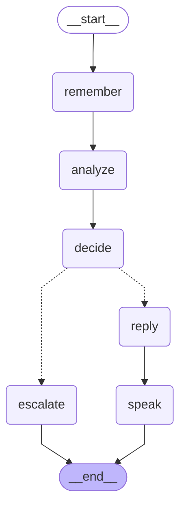
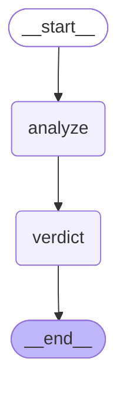

# Callas LangGraph pipelines

Generated by `python -m orchestrator.show_graph --out docs/diagrams/langgraph.md`.
Code: `modules/orchestrator/graph.py`. The branch after `decide` is `route_after_decide`, which reads only `Decision.auto_reply`.

## Turn graph (one call turn)

## Message graph (one text message)

