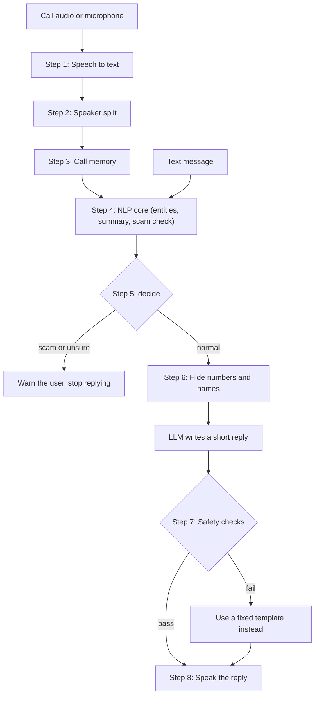

# How Callas works

This page walks through one scam call, step by step. For each step it says what happens, which NLP technique does the work, and why that step is there. The examples are real output from the code, not made up.

If you only want to run the project, read the [README](../README.md). If you want the full design, read [`spec.html`](spec.html).

## The example call

A caller pretends to be from the post office. Speaker A is the scammer. Speaker B is the person who got the call.

```text
A: สวัสดีครับ ผมโทรจากไปรษณีย์ไทย มีพัสดุของคุณถูกตีกลับ
   (Hello, I am calling from Thailand Post. Your parcel was sent back.)
B: ผมไม่ได้สั่งของนะ
   (I did not order anything.)
A: ต้องจ่ายค่าธรรมเนียม 1,500 บาท โอนเข้าบัญชี 123-4-56789-0 แล้วบอกรหัส OTP 482915
   (You must pay a 1,500 baht fee. Transfer to account 123-4-56789-0, then tell me the OTP 482915.)
```

The first turn sounds almost normal. A real parcel company could say it. The scam only shows in turn 3, when the caller asks for money and an OTP. This is why Callas keeps the whole call in memory and checks every new turn together with the old ones.

## The whole flow



A text message skips steps 1 to 3 and 5 to 8. It only goes through the NLP core and gets a verdict.

The LLM never decides whether to warn or to reply. Step 5 is plain `if` rules. We did this on purpose, because an LLM can be talked into anything by a good scammer.

---

## 1. Speech to text

**What happens.** The audio goes in, Thai text comes out. We use the Typhoon ASR model through the `pythaiasr` package. It runs on your own machine with ONNX, so the call audio never leaves it.

**Technique.** Automatic speech recognition (ASR). The model hears 16 kHz audio and predicts Thai characters.

**Why it matters.** Every later step reads text. If the ASR writes `โอนเงนิ` instead of `โอนเงิน`, the later steps see a different word. That is why we also keep a check on text quality (see "Known limits" below).

**Live calls work differently.** The microphone sends small chunks of audio. We have to decide where one turn ends and the next starts:

| Rule | Value | What it does |
|---|---|---|
| Voice activity detection | energy above 0.015 | A 20 ms frame with more energy than this counts as speech |
| Silence that closes a turn | 0.8 s | After 0.8 s of quiet, the turn is finished |
| Pre-roll | 0.3 s | We keep 0.3 s of audio from before the speech starts, so the first syllable is not cut |
| Shortest turn | 0.5 s | Anything shorter is noise and is dropped |
| Longest turn | 15 s | A very long turn is closed even if the caller keeps talking |

The code is in `modules/asr_diarization/streaming.py`.

A person who pauses to think can go quiet for more than 0.8 s. So the agent waits another 0.7 s before it replies. If the same speaker starts again in that time, the two turns are joined and get one reply (`REPLY_DELAY_S` in `modules/orchestrator/live.py`). The screen still shows both turns.

## 2. Speaker split

**What happens.** The audio is cut into pieces, and each piece gets a speaker name. Names are `A`, `B`, `C` and so on, in the order people first speak.

**Technique.** Speaker diarization, with the Nemotron-3 model (default) or Pyannote. It answers "who spoke when". It does not know who the people are.

**Why it matters.** "Send me the money" means something different from the caller than from the person who got the call. The scam check reads `A: ... B: ...` so it knows who is asking and who is refusing.

```text
A: สวัสดีครับ ผมโทรจากไปรษณีย์ไทย ...
B: ผมไม่ได้สั่งของนะ
```

## 3. Call memory

**What happens.** Every turn goes into a `CallState`. It lives in RAM only and is deleted when the call ends.

**Technique.** A sliding window with a summary. The newest 6 turns stay word for word. When the text gets over 1,500 tokens, older turns are folded into a short summary. Tokens are counted as Thai words with PyThaiNLP's `newmm` tokenizer.

**Why it matters.** Two reasons.

1. Scams start slow. Turn 1 above looks normal, and only turns 1 to 3 together look like a scam.
2. The LLM has a limit on how much text it can read. A 20 minute call cannot fit. The window keeps the newest part exact and the old part short.

Since PR #32 the agent's own replies go into memory too, as `agent:` lines. Before that, the agent could not see what it had already said, so it repeated itself.

## 4. NLP core

This step turns the text into three things: entities, a summary and a scam label. The code is in `modules/nlp_core/`.

### 4a. Entities (rules)

**What happens.** We find the parts of the text that matter most for a scam: phone numbers, bank accounts, OTP codes, links and money amounts.

**Technique.** Regular expressions. Thai digits (`๑๒๓`) are first mapped to `123`, so one rule handles both. When two matches overlap, the longest one wins.

```text
Turn 3 → MONEY  "1,500 บาท"
         BANK_ACCOUNT  "123-4-56789-0"
         OTP  "482915"
```

**Why it matters.** These are the exact things a safe reply must never repeat. The entity list is also what the redaction step uses to hide them (step 6).

**Honest limit.** The rules find no names and no organisations. A trained NER model (WangchanBERTa) is planned. Until then the reply safety check blocks name words such as `คุณ` instead (step 7).

### 4b. Summary (LLM)

**What happens.** The LLM writes one or two Thai sentences: what does the speaker want? The prompt tells it not to copy any number.

**Technique.** Prompt-based abstractive summarization with an LLM served by vLLM (Qwen in our setup).

**Why it matters.** The summary is what the user reads on the warning screen. It is also what call memory keeps when old turns are folded away.

### 4c. Scam check (LLM)

**What happens.** The LLM reads the whole call so far and answers with one label:

| Label | Meaning |
|---|---|
| `normal` | An ordinary conversation |
| `fake_authority` | Pretends to be police, a bank or a delivery company |
| `romance` | Builds a relationship to ask for money |
| `investment` | Promises profit that is too good |
| `phishing_otp` | Asks for an OTP, a password or account data, or sends a fake link |
| `lottery` | Says you won a prize, but you must pay first |

**Technique.** Zero-shot text classification with a prompt. We plan to replace it with a fine-tuned WangchanBERTa model behind the same function, so nothing else has to change.

For our example, turn 3 should get `fake_authority`.

**Why it matters, and the safe default.** If the LLM answers something we cannot read, the result is "scam, type unknown, confidence 0.0". It is never "safe". When Callas is unsure, it warns.

## 5. The decision

**What happens.** A short function, `decide()`, looks at the result. No LLM is involved.

```text
call already escalated            → keep warning
scam, confidence 0.7 or higher    → warn: "high-confidence scam"
scam, confidence below 0.7        → warn: "low-confidence scam, review"
normal                            → allow an automatic reply
```

Once a call is marked as a scam, it stays marked until it ends. A scammer cannot make the call look safe again by being polite in the next turn.

**Why it matters.** The rule is simple enough to test and to explain. The same input always gives the same answer.

## 6. Hide the sensitive parts

**What happens.** If the call is normal, the LLM will write a reply. Before it reads the call, we replace every sensitive part with a label.

**Technique.** Rule-based redaction. It uses the entity list from step 4a, plus rules for digits in any script, spoken numbers (`แปดหนึ่งสอง...`) and links.

```text
Before: ต้องจ่ายค่าธรรมเนียม 1,500 บาท โอนเข้าบัญชี 123-4-56789-0 แล้วบอกรหัส OTP 482915
After:  ต้องจ่ายค่าธรรมเนียม [MONEY] โอนเข้าบัญชี [BANK_ACCOUNT] แล้วบอกรหัส OTP [OTP]
```

**Why it matters.** The best way to stop a model from leaking a number is to never show it the number. This is the first of two locks. Step 7 is the second.

## 7. Safety checks on the reply

**What happens.** The LLM writes a short reply. The reply must pass every check below. If any check fails, Callas speaks a fixed template instead.

| Check | What it catches |
|---|---|
| Not empty, at most 200 characters | A rambling or empty answer |
| Leak check | Digits, spoken numbers, links, words like OTP or `บัญชี`, name words like `คุณ`, English words, and anything from the entity list |
| Spelling check | A Thai word that is not in the PyThaiNLP dictionary, or a tone mark in the wrong place. The voice reads the text aloud, so garbled Thai would sound wrong |
| Leak judge (optional) | A second LLM that can only block more, never allow more |

**Technique.** Regexes and Unicode normalization for the leak check. Dictionary lookup on `newmm` tokens for the spelling check.

```text
"ขอบคุณค่ะ โทรมาเรื่องอะไรคะ"     → passes
"โอนเข้า 123-4-56789-0 ค่ะ"       → blocked: digit, entity:BANK_ACCOUNT
"รหัส OTP คือ 482915"              → blocked: digit, keyword:otp, entity:OTP
"คุณสมชายไม่อยู่ค่ะ"                → blocked: name_word:คุณ
"กดลิงก์ bit.ly/abc ค่ะ"            → blocked: url_or_email
```

**Why it matters.** The reply is spoken in the user's name. One leaked account number or one "yes, he is home" gives a scammer exactly what they want. The check is strict on purpose. A false alarm costs a bland template. A miss costs real money.

**The trade-off.** A strict check also blocks natural replies. That is why the agent sounds stiff. It blocks every digit, so it cannot say today's date. PR #33 changes this for the date and time only.

## 8. Voice

**What happens.** The reply text is turned into speech with PyThaiTTS (FastThaiG2P). The TTS step runs the leak check again before it speaks. Callas pauses the microphone while the reply plays, so it does not transcribe its own voice.

**Technique.** Grapheme-to-phoneme conversion, then speech synthesis.

---

## The same call, end to end

| Turn | Who | What the system does |
|---|---|---|
| 1 | A: "I am calling from Thailand Post..." | Memory has 1 turn. This looks like a real delivery call, so the scam check can say `normal` and the agent may reply. |
| 2 | B: "I did not order anything." | Memory has 2 turns. The caller's story is still plausible, so this can stay `normal`. |
| 3 | A: "Pay 1,500 baht to account ... tell me the OTP ..." | Entities found: MONEY, BANK_ACCOUNT, OTP. The scam check reads all 3 turns and should say `fake_authority`. Any scam label makes `decide()` escalate. No reply is written. The user sees a warning and the summary. |
| 4+ | Anything | The call stays marked as a scam. No automatic reply. |

A slower scam, such as a romance scam over ten turns, never has one turn that is obviously bad. It needs the memory. That is the case we measure ("turns until escalation, memory on and off").

## Where each NLP technique is used

| Technique | Step | Tool |
|---|---|---|
| Speech recognition | 1 | Typhoon ASR (`pythaiasr`) |
| Voice activity detection | 1 (live) | Energy threshold per 20 ms frame |
| Speaker diarization | 2 | Nemotron-3, or Pyannote |
| Word tokenization | 3, 7 | PyThaiNLP `newmm` |
| Entity extraction | 4a | Regular expressions |
| Summarization | 4b | Prompted LLM (Qwen on vLLM) |
| Text classification | 4c | Prompted LLM, WangchanBERTa planned |
| Redaction | 6 | Rules + the entity list |
| Spell check | 7 | PyThaiNLP dictionary |
| Text to speech | 8 | PyThaiTTS |

## Known limits

- **Entities are rules only.** No names or organisations are found yet. The reply check blocks name words as a stand-in.
- **The LLM's confidence is 1.0 or 0.0.** It names a label but gives no real probability. A fine-tuned classifier would give one.
- **ASR mistakes pass straight through.** Later steps see whatever the ASR wrote.
- **The reply check is strict.** It protects the user and costs natural replies.
- **We have no real Thai scam call dataset.** Training data is generated or scraped, so scores on it need careful reading.

## Not merged yet

These are in open pull requests and are not on `main` today.

- **#33.** A conversational reply prompt, and the date and time in the reply.
- **#35.** One shared `normalize_text` for training and the web system, and an optional spelling fixer for transcripts (`AUTOCORRECT=pythainlp`, off by default). It can pick a wrong word: `โอนเงนิ` becomes `ถอนเงิน` ("withdraw"), so we keep it off.
- **#34.** `pythaiasr` 2.3, which adds the Typhoon Nemotron streaming models.

## Where to read the code

| Step | Code |
|---|---|
| 1, 2 | `modules/asr_diarization/` |
| 3, 5, 6, 7, 8 | `modules/tts_voice_agent/` (`memory.py`, `decision.py`, `redact.py`, `leak.py`, `spelling.py`, `speech.py`) |
| 4 | `modules/nlp_core/` and the prompts in `modules/llm_serving/prompts/` |
| The graph that joins them | `modules/orchestrator/graph.py` |
