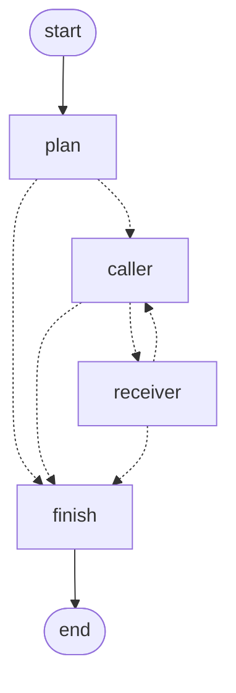

# data_pipeline: simulated calls

Makes labelled Thai calls for the dataset. DSPy ChainOfThought agents act out each call turn
by turn:

| Agent | Role |
|---|---|
| `planner` | before a scam call, writes the caller's step-by-step plan from the scenario and the newest notes in the scam wiki |
| `scam_caller` | plays a scammer of one of the 5 spec types, following the plan, paced so the ask comes at a set turn |
| `legit_caller` | plays an honest caller (bank, courier, hospital, family); some are hard cases that mention OTPs or accounts |
| `receiver` | answers the phone as one person (age, job, region, family, phone habits, what they know about scams); never told whether the call is a scam |
| `judge` | reads the finished call, checks it shows what it should, writes the reference summary |
| `pattern_extractor` | turns a news article into a scam wiki note (`python -m data_pipeline.patterns add`) |

The label comes from the config, never from a model. Each turn is spoken with PyThaiTTS
(VachanaTTS2, a different voice per speaker), and the turns are joined into one WAV with real
start and end times in `speaker_turns`.

## How a call runs

Each call is a LangGraph graph (`simulate.build_graph`). The drawing below comes from
`CALL_GRAPH.get_graph().draw_mermaid()`:



- `plan`: scam calls only, writes the plan once.
- `caller` / `receiver`: add one turn each and save the call.
- The dotted edges are one routing function, `next_step`: whose turn it is, or `finish` when
  someone hung up or the call reached its length.
- `finish`: builds the text, joins the audio, asks the judge, sets accepted or rejected.
- A malformed model answer or a rate limit is retried by LangGraph's `RetryPolicy` (waits of 5,
  15 and 45 s). A server that is down stops the run.

The agents, the store and the config reach the nodes as LangGraph run context
(`context_schema`), not as state. The graph has no checkpointer: every node saves the call to
the SQLite store, so a stopped run resumes from the last saved turn.

## Run

```
python -m data_pipeline.synthesize --type all --n 20               # 20 calls per type
python -m data_pipeline.synthesize --type romance --n 200 --workers 4
python -m data_pipeline.synthesize --type all --n 5 --no-tts         # text only, faster
python -m data_pipeline.synthesize --check-config --config my_cfg/   # check a config, no LLM
python -m data_pipeline.synthesize --export data/synthetic/calls.jsonl --approved-only
```

Calls go into one SQLite file, `data/synthetic/calls.db` (gitignored; `--db` picks another),
with audio in `data/synthetic/audio/`. Run from the repo root. `--export` writes the accepted
calls as JSON lines in the spec's schema, for build_dataset; `--approved-only` keeps the ones a
person approved. Calls from an older run that wrote one JSON file per call load with
`--import-json <folder>`.

Review the calls at `/dataset` in the web demo: the call reads as a chat, each message plays on
its own, the agents' reasoning and the caller's plan are one click away, and approve or reject is
saved in the store. Set `CALLAS_DATASET_DB` to review another database.

## Choose who answers

By default each call samples a receiver (see `receivers` in `config/scenarios.yaml`), and
`profile_share` of calls use one of the people written out under `profiles`. To have every call
in a run answered by one person:

```
python -m data_pipeline.synthesize --type romance --n 5 --receiver teacher_cm
python -m data_pipeline.synthesize --type all --n 2 --receiver-file my_person.yaml
```

`--receiver` takes the `key` of a profile in `scenarios.yaml`. `--receiver-file` takes a YAML file
with the same fields as a profile:

```yaml
key: nurse_kk
gender: female
age: 41
occupation: nurse on night shifts
education: bachelor's degree
region: Khon Kaen
family: lives with two teenage children
digital_literacy: uses mobile banking every day
scam_awareness: reads police warnings on Facebook
temperament: "skeptical: asks who is calling"
ending: ends the call politely
speech: polite, a little tired
```

A call with a chosen receiver gets its own id (`romance_nurse_kk_00003`), so it never replaces
the sampled call for the same seed.

## Change how the agents behave

Everything the agents are told lives in `config/`:

| File | What it holds |
|---|---|
| `agents.yaml` | each agent's instructions and field descriptions, model, temperature and max_tokens; caller pacing text; receiver persona and when it may hang up; judge's description of each call type; TTS voices |
| `scenarios.yaml` | the scam and normal scenarios, the receiver pools (jobs, temperaments, endings), call length and pacing numbers |
| `details.yaml` | names, banks, made-up companies, link words and amounts that fill the slots |

To try a variant without touching the default:

1. Copy the folder: `cp -r modules/data_pipeline/config my_cfg`
2. Edit the YAML.
3. Check it: `python -m data_pipeline.synthesize --check-config --config my_cfg`
4. Generate into its own folder: `--config my_cfg --out data/synthetic/my_cfg`

The loader refuses a config that would break the run: an unknown key, a renamed field under
`fields`, a slot that does not exist (`{ADDRESS}`), a missing scam type, or a gender with fewer
than two voices. Every record stores the config name and a hash of its content, and a run will
not resume a call that was started with a different config.

Before you edit:

- Field names under `fields:` are fixed (the code reads them). Change the text, not the keys.
- Agents must write details as slots: `{CALLER_NAME} {RECEIVER_NAME} {ORG} {PHONE}
  {BANK_ACCOUNT} {OTP} {URL} {MONEY}`. Code fills them with made-up values, which gives exact
  entity spans and keeps real numbers out of the data.
- Seeds pick scenarios by list position. Adding a scenario in the middle of a list changes which
  call a seed makes; the config hash keeps old and new records apart.
- Temperature: qwen3.8 garbled Thai spelling at 0.3, so speakers run at 0.0. Variety comes from
  the sampled scenario, receiver, plan and pacing.

## Checks before a call is accepted

A call is marked `rejected` (it stays on disk and shows on `/dataset`) when:

- it has fewer turns than `calls.min_turns`
- an agent wrote an unknown slot or a bare number
- a tone mark comes before a vowel
- the judge says it does not show the intended call, or that it names the label outright
- a scam call has no scam move
- the judge finds a scam in a normal call

The scam start turn is the caller agent's own flag. When the caller did not flag one, the
judge's answer is used, and `generation.scam_start_from` says which.

The judge's 1-5 "sounds natural" score is shown but does not reject calls: in testing it
reported spelling errors in correctly spelled words.

## Install

Needs the `dspy` and `data` extras. VachanaTTS2 depends on `onnxruntime`; on a machine with
`onnxruntime-gpu`, install it without dependencies so pip does not replace the GPU build:

```
pip install -e ".[dspy,data]"
pip install --no-deps vachanatts==0.0.7 ssg==0.0.8
```

VachanaTTS2 downloads its four voices (about 240 MB) into `./voices/` of the folder you run
from, the first time each is used. Run from the repo root so there is one copy; `voices/` is
gitignored.

## Scam wiki

The pattern notes the scam caller's planner reads are kept as Markdown, one page per scam type, in
`docs/scam-wiki/`. The pages are the source of truth and the SQLite store is a copy.

```
python -m data_pipeline.patterns sync                                    # pages -> store
python -m data_pipeline.patterns add --type romance --file article.txt   # LLM note -> page -> store
python -m data_pipeline.patterns list --type romance
python -m data_pipeline.patterns disable --type romance 2                # sets "active: no"
```

Run `sync` after you edit a page. It replaces the store's notes for each type with the page's
notes, so a deleted note disappears from the store. The page format and the rules for notes are in
`docs/scam-wiki/README.md`; the code is in `wiki.py`.
