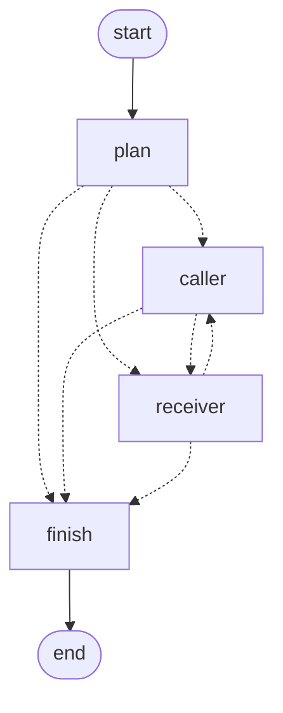

# data_pipeline: simulated calls

Makes labelled Thai calls for the dataset. DSPy ChainOfThought agents act out each call turn by turn:

| Agent | Role |
|---|---|
| `planner` | before a scam call, writes the caller's step-by-step plan from the scenario and the newest notes in the scam wiki |
| `scam_caller` | plays a scammer of one of the 5 spec types, following the plan, paced so the ask comes at a set turn |
| `legit_caller` | plays an honest caller (bank, courier, hospital, family). Some are hard cases that mention OTPs or accounts |
| `receiver` | answers the phone as one person (age, job, region, family, phone habits, what they know about scams). It is never told whether the call is a scam |
| `judge` | reads the finished call, checks it shows what it should, writes the reference summary |
| `pattern_extractor` | turns a news article into a scam wiki note (`python -m data_pipeline.patterns add`) |

The label comes from the config, never from a model. Each turn is spoken with PyThaiTTS (VachanaTTS2, a different voice per speaker). The turns are joined into one WAV, with real start and end times in `speaker_turns`.

You can also make one call from the browser at `/studio` and watch it being written. See [`backend/README.md`](../../backend/README.md#studio).

## Install

You need the `dspy` and `data` extras. VachanaTTS2 depends on `onnxruntime`. On a machine with `onnxruntime-gpu`, install it without dependencies so pip does not replace the GPU build:

```
pip install -e ".[dspy,data]"
pip install --no-deps vachanatts==0.0.7 ssg==0.0.8
```

VachanaTTS2 downloads its four voices (about 240 MB) into `./voices/` of the folder you run from, the first time each is used. Run from the repo root so there is one copy. `voices/` is gitignored. The models run on the vLLM server in `.env` (`VLLM_BASE_URL`).

## Run

Run from the repo root.

```
python -m data_pipeline.synthesize --type all --n 20               # 20 calls per type
python -m data_pipeline.synthesize --type romance --n 200 --workers 4
python -m data_pipeline.synthesize --type all --n 5 --no-tts         # text only, faster
python -m data_pipeline.synthesize --check-config --config my_cfg/   # check a config, no LLM
python -m data_pipeline.synthesize --export data/synthetic/calls.jsonl --approved-only
```

`--type` is one of the five scam types, `benign`, or `all`. `--start-seed` changes where the seeds start. Seeds give the same calls with the same config.

- Calls go into one SQLite file, `data/synthetic/calls.db` (gitignored; `--db` picks another). Audio is in an `audio/` folder next to it.
- Press Ctrl-C to stop. Queued calls are cancelled and running calls stop after their current turn. The command prints `stopped by user; rerun to resume` and exits with a non-zero code. Every turn is saved, so the same command resumes.
- A rerun skips finished calls, says how many, and warns if any were made with a different config.
- Do not run two commands that write the same `--db` at the same time. Calls are not locked, so both would write over each other's turns. Give each run its own `--db`.
- `--export` writes the accepted calls as JSON lines in the spec schema. `--approved-only` keeps the ones a person approved.
- `--import-json <folder>` loads calls from an older run that wrote one JSON file per call.
- `--wiki` picks the scam wiki folder that is synced into the store before a run (default `docs/scam-wiki`).

Review the calls at `/dataset` in the web demo. Each message plays on its own, the agents' reasoning and the caller's plan are one click away, and approve or reject is saved in the store. Set `CALLAS_DATASET_DB` to review another database.

## How a call runs

Each call is a LangGraph graph (`graph.build_graph`). The drawing comes from `CALL_GRAPH.get_graph().draw_mermaid()`:



- `plan`: scam calls only. Writes the plan once.
- `caller` and `receiver`: add one turn each and save the call.
- The dotted edges are one routing function, `next_speaker`. It picks whose turn it is, or `finish` when someone hung up or the call reached its length. `plan` can lead to either speaker because a resumed call may be waiting for either one.
- `finish`: builds the text, joins the audio, asks the judge, and sets accepted or rejected.
- LangGraph's `RetryPolicy` retries only errors that come from the model: a reply DSPy cannot parse, and rate limits or 5xx answers (`turns.is_model_error`). Waits are 5, 15 and 45 s. A bug or a store error fails at once and leaves the call unfinished. A server that is down stops the run.

The state (`CallState`) holds only what changes during a call: the briefing, the turns, the status and the ending. Each node returns only the fields it changed. The agents, the store, the config and the call as it was loaded reach the nodes as LangGraph run context (`context_schema`), not as state. `to_record` lays the state over the loaded call to get the record the store saves.

A call is a `CallRecord` (`records.py`): the spec's fields, a `Generation` block with the turns (`Turn`), the scam caller's plan (`Briefing`) and the judge's answer (`Judge`), and a `Review` block. They are dataclasses. Dicts appear only at the edge: `Store.load_call`, `Store.save_call` and `Store.calls` convert with `from_dict` and `to_dict`, and the JSON export and the studio's events carry the dict. `to_dict` keeps the key order the store has always written, so the stored JSON does not change. The web pages read the dicts from `Store.load` and `Store.call_dicts`.

There is no checkpointer. Every node saves the call to the SQLite store, so a stopped run resumes from the last saved turn. A node saves before it returns, and LangGraph adds the new turn to the state only after the node returns, so a retry after a failed save never adds it twice.

### Read the code in this order

1. `graph.py`: the call graph. The state, the nodes `plan`, `caller`, `receiver` and `finish`, the routing function and `build_graph`.
2. `records.py`: the call record and its parts.
3. `turns.py`: one turn. What each agent is given, how the conversation is cut to fit the prompt, slot filling and the problems a line can have. Also the planner.
4. `finish.py`: the finished call. Its text, the receiver's leaks, the judge, where the scam starts and the reasons to reject it.
5. `audio.py`: speaking each turn and joining the call's audio.
6. `simulate.py`: `run_call`, which loads or creates the record and runs the graph.
7. `streaming.py`: the same graph streamed step by step for the `/studio` page. `capture.py` records each agent's prompt and answer for it, and `demo.py` has the scripted LM of demo mode. `live.py` gathers their names for `backend/studio.py`.
8. `synthesize.py`: the command line. Then `store.py`, `agents.py`, `config.py` and `fill.py`.

## Export for the classifier notebook

```
python -m data_pipeline.synthesize --export-notebook dataset/scam_dataset_generated.csv
python -m data_pipeline.synthesize --export-notebook out.csv --store other/calls.db --text asr
```

This writes the csv that [`notebooks/scam_classifier_phayathaibert.ipynb`](../../notebooks/README.md) reads next to the hand-written `dataset/scam_dataset.csv`. The notebook looks for `dataset/scam_dataset_generated.csv`. The export reads the store without changing it, needs no config and no LLM, and prints how many rows it wrote and how many calls it skipped for each reason. It is a different file from `--export`, which writes JSON lines.

Each row is one call:

- `dialogue`: the turns on one line, as `ผู้โทร: ... ผู้รับ: ...`
- `scam_class`: `Scam` or `Not a Scam`
- `scam_type`: one of the five spec names, empty for a normal call
- `source` (`simulated`), `group_hint` (call type and scenario, for example `romance/engineer_abroad`), `scam_start_turn` (0-based, empty for a normal call) and `call_id`
- `receiver_leaked` and `first_leak_turn`, when the store has those columns

The file is UTF-8 with a byte order mark, like every csv in the notebook.

Only calls the simulator accepted and a person approved on `/dataset` are written. A call is skipped, and counted under a reason, when the notebook's cleaning would change what was reviewed. Examples are a speaker tag, text in square brackets, a stage note such as `(เสียงร้องไห้)`, the English words Scam, Phishing or Impersonation, an empty turn, two turns in a row from one speaker, fewer than two turns, or a scam type outside the five. The full list is in `export.py`. The rules are copied from the notebook, and a test fails if the notebook's version changes.

`--text asr` writes the ASR transcript of each turn's audio instead of the written line, so the model trains on text like the one it reads in production. Transcripts are kept in `eval/results/asr_cache/typhoon_asr.export.json` (or the folder in `CALLAS_ASR_CACHE`). Each entry holds a hash of the turn's text and audio file name, so a call you regenerate under the same id is transcribed again. A turn that is not cached is transcribed with pythaiasr when it is installed and the audio file exists. If that is not possible, the call is skipped as `asr_incomplete`, because a call with some turns written and some spoken would not match production.

How the notebook splits generated rows is in [`notebooks/README.md`](../../notebooks/README.md#generated-data). One limit: all calls of a scenario stay in one split. Each type has 4 to 6 scenarios, so the type model sees few distinct scenarios. Add scenarios in `config/scenarios.yaml` before you generate more calls of the same type.

## Choose who answers

By default each call samples a receiver (`receivers` in `config/scenarios.yaml`). `profile_share` of calls use one of the people written out under `profiles`, and these keep the plain call id. To have every call in a run answered by one person:

```
python -m data_pipeline.synthesize --type romance --n 5 --receiver teacher_cm
python -m data_pipeline.synthesize --type all --n 2 --receiver-file my_person.yaml
```

`--receiver` takes the `key` of a profile in `scenarios.yaml`. `--receiver-file` takes a YAML file with the same fields as a profile:

```yaml
key: nurse_kk
gender: female
age: 41
occupation: nurse on night shifts
education: bachelor's degree
region: Khon Kaen
family: lives with two teenage children
digital_literacy: uses mobile banking every day
scam_awareness: reads police warnings on Facebook
temperament: "skeptical: asks who is calling"
ending: ends the call politely
speech: polite, a little tired
```

A call with a chosen receiver gets its own id (`romance_nurse_kk_00003`), so it never replaces the sampled call for the same seed. The `key` in a `--receiver-file` must not already be used in `scenarios.yaml`. The choice is stored as a short hash (`generation.call.receiver_override`). A half-done call does not resume with a different receiver, so use the same option again or delete the call. The receiver agent never sees the `key`.

## Change how the agents behave

Everything the agents are told lives in `config/`:

| File | What it holds |
|---|---|
| `agents.yaml` | each agent's instructions and field descriptions, model, temperature and max_tokens; caller pacing text; receiver persona and when it may hang up; the judge's description of each call type; TTS voices; `speech` and `context` |
| `scenarios.yaml` | the scam and normal scenarios, the receiver pools (jobs, temperaments, endings), call length and pacing numbers |
| `details.yaml` | names, banks, made-up companies, link words, amounts and address parts that fill the slots |

To try a variant without touching the default:

1. Copy the folder: `cp -r modules/data_pipeline/config my_cfg`
2. Edit the YAML.
3. Check it: `python -m data_pipeline.synthesize --check-config --config my_cfg`
4. Generate into its own database: `--config my_cfg --db data/synthetic/my_cfg.db`

Every record stores the config hash (a hash of the parsed YAML). Any change to `agents.yaml` gives a new hash. A call left unfinished with the old config is not resumed with the new one: finish it with the old config or delete it. A config folder with no `addresses` in `details.yaml` still loads and uses the built-in parts.

The loader refuses a config that would break the run:

- an unknown key, a renamed field under `fields`, or a slot that does not exist (`{HOUSE_NUMBER}`)
- a missing scam type, or a gender with fewer than two different voices or names
- a pacing or stage text that `str.format` cannot fill. Only `{turn}` and `{turns}` exist, stage texts only `{turn}`, and a literal brace is written `{{`
- a receiver age range that is not `[low, high]` within 10 to 100
- a reveal turn that no call can fit: the shortest call a reveal turn can get is `2 * reveal + 4` turns (within `max_turns`), the caller's last own turn is `(turns - 1) // 2`, and the ask must come one turn before that at the latest
- an agent whose `max_tokens` plus `context.safety_margin_tokens` is not below `context.window_tokens`

Before you edit:

- Field names under `fields:` are fixed, because the code reads them. Change the text, not the keys.
- Agents must write details as slots: `{CALLER_NAME} {RECEIVER_NAME} {ORG} {PHONE} {BANK_ACCOUNT} {OTP} {URL} {MONEY}` and the receiver's own `{RECEIVER_PHONE} {RECEIVER_ACCOUNT} {ID_CARD} {BIRTH_DATE} {ADDRESS}`. Code fills them with made-up values. This gives exact entity spans and keeps real numbers out of the data.
- Seeds pick scenarios by list position. Adding a scenario in the middle of a list changes which call a seed makes. The config hash keeps old and new records apart.
- All agents run at temperature 0.0, because a model garbled Thai spelling at 0.3. Variety comes from the sampled scenario, receiver, plan and pacing.

## Receiver leaks

A real victim sometimes gives personal details away. Those are the calls a scam classifier most needs to see. The receiver may do this when the person it plays would: its instructions say a trusting or unsure person who knows little about scams often goes along, while a skeptical or scam-aware person treats the call as ordinary until something seems off, then asks who is calling, refuses, or hangs up. In a test of 20 phishing_otp and fake_authority calls with trusting or unsure profiles, 7 leaked an OTP; 10 skeptical calls leaked nothing. The pronoun change (ฉัน/เรา instead of ดิฉัน) and the normal-until-triggered wording did not change these counts: 7 of 20 and 0 of 10 both before and after. Three fake_authority scenarios (`police_warrant`, `dsi_case`, `court_summons`) ask for the receiver's ID card number and another detail to "verify identity"; with those, 5 of 20 trusting fake_authority calls leaked (#99). It gives details only through its own slots, so no real data appears:

| Slot | Value | Entity label |
|---|---|---|
| `{OTP}` | 6 random digits | `OTP` |
| `{RECEIVER_PHONE}` | a made-up mobile number | `PHONE` |
| `{RECEIVER_ACCOUNT}` | a made-up bank account | `BANK_ACCOUNT` |
| `{ID_CARD}` | 13 random digits as `1-2345-67890-12-3`. The check digit is not computed, so it is never a valid ID number | `ID_CARD` |
| `{BIRTH_DATE}` | day, month and Buddhist-era year, for example `12 มีนาคม 2511`, matching the receiver's age on 1 July 2025 | `BIRTH_DATE` |
| `{ADDRESS}` | built from the made-up parts under `addresses` in `details.yaml` | `ADDRESS` |

The receiver also hears the caller's numbers and links as slots (`{MONEY}`, `{PHONE}`, `{BANK_ACCOUNT}`, `{URL}`, and `{OTP}` if the caller says one), so a receiver that repeats one writes the slot instead of digits that would get the call rejected as `number_without_slot`. Repeating the caller's slots is not a leak: only the slots in the table above are.

`ID_CARD`, `BIRTH_DATE` and `ADDRESS` are in `nlp_core.types.ENTITY_LABELS`.

Code finds leaks from the slots a receiver line uses. The model never reports them. `{RECEIVER_NAME}` does not count, because saying your name when you answer is not a leak. A caller cannot know the receiver's details. A caller turn that uses one of those slots gets the problem `caller_used_receiver_slot`, and the call is rejected.

Each receiver turn gets `leaked`, the labels it gave away in order of first use. When the call finishes, `generation.receiver_leaked` has the sorted labels of the whole call and `generation.first_leak_turn` has the 0-based index of the first leaking turn (`null` if none). The store keeps them in `calls.receiver_leaked`, `calls.first_leak_turn` and `turns.leaked`. An older `calls.db` gets the columns when it is opened. `/dataset` shows a red "Leaked: ..." tag under a receiver message that leaked.

## How numbers are spoken

VachanaTTS reads `158-5-96045-2` as one number with minus signs. So the voice is not given the stored text. `spoken.py` builds a spoken version from the turn's entity spans and keeps it on the turn as `spoken_text`. The stored `text` and its spans keep the digits, because the digits are the labels.

| Label | Said as |
|---|---|
| `PHONE`, `BANK_ACCOUNT`, `ID_CARD` | digit by digit per group: `158-5-96045-2` is "หนึ่งห้าแปด ขีด ห้า ขีด เก้าหกศูนย์สี่ห้า ขีด สอง" |
| `OTP` | digit by digit, no dashes |
| `MONEY` | place value: `49,500 บาท` is "สี่หมื่นเก้าพันห้าร้อยบาท" |
| `BIRTH_DATE` | day and year as numbers, month as written |
| `ADDRESS` | house and soi numbers by place value (`45` is สี่สิบห้า, `12/3` is สิบสองทับสาม). A 5-digit postcode digit by digit |
| `PERSON`, `ORG`, `URL` | as written |

People do not always say "ขีด". Often they only pause between groups. In the audio a pause is a comma, because VachanaTTS barely pauses on a plain space. Each call picks one style from its seed (`generation.speech_style`, `dash` or `pause`). The share of `dash` calls is `speech.say_dash_share` in `agents.yaml` (0 to 1, default 0.5). Text outside the spans is never changed.

## Context window

`context` in `agents.yaml` sets `window_tokens: 100000` (the window of the model on the gateway) and `safety_margin_tokens: 2000`. Each agent's prompt may use `window_tokens - lm.max_tokens - safety_margin_tokens`.

`budget.py` formats the exact messages DSPy sends and estimates their size as UTF-8 bytes / 3, rounded up. That is about one token per Thai character, the worst case. It over-counts English, which is the safe side. When a prompt is over budget:

- speakers (both callers and the receiver) keep the first 2 turns and as many of the newest turns as fit. The turns between are replaced by one line, `(... N earlier turns not shown ...)`
- the planner drops the oldest pattern notes until it fits (`generation.briefing.notes_used` lists the ones it used)
- if the prompt still does not fit (a huge newest turn, or 3 turns or fewer), the model is not asked and the call ends `rejected` with the reason `too_long_for_context`
- the judge must read the whole call, so a call that does not fit is `rejected` with `too_long_for_judge`
- `patterns add` cuts the article to the longest start that fits, never more than `MAX_ARTICLE_CHARS` (12000)

Every turn stores the estimated size of its prompt as `prompt_tokens`. A normal call is a few thousand tokens, so none of this changes a normal run.

## Checks before a call is accepted

A call is marked `rejected` (it stays on disk and shows on `/dataset`) when:

- it has fewer turns than `calls.min_turns`
- an agent wrote an unknown slot (`unknown_slot:NAME`)
- a line has a number the agent wrote itself (`number_without_slot`): 4 or more digits in a row, or digit groups joined by `,` `.` `-` or a space with 3 or 4 digits after the first group (`50,000`, `5 000`, `081.234.5678`). Small numbers (`3`, `15`) and times (`10.30`) are fine
- a slot is left unfilled, so `{` or `}` is in the line (`stray_brace`)
- a line has a line break or starts with `A:` or `B:` (`line_break`)
- a tone mark comes before a vowel
- the judge's confidence score is 50% or less (`judge_low_confidence`). The score is 25 points for a clear scam or not-scam, 25 for showing the intended call and 50 for realistic language. At or below 50% it is the only judge reason given, and none of the judge checks below are weighed
- the judge says it does not show the intended call, or that it names the label outright
- a scam call has no scam move
- the judge finds a scam in a normal call

The scam start turn is the caller agent's own flag. A flag on a turn before the call's reveal turn is ignored. When the caller did not flag one, the judge's answer is used if it points at a caller turn, and `generation.scam_start_from` says which.

If the model keeps failing after the retries, the call is marked `rejected` with `llm_error:<Name>`. Any other error leaves the call unfinished. The command prints the call id and the error, counts it as `error` in the summary, exits with code 1, and the next run resumes the call.

The judge no longer gives a 1 to 5 "sounds natural" score (#98). In testing it scored calls down for spelling errors in correctly spelled words, even when told not to and even with a separate field for spelling claims, and the score never rejected a call. Calls judged before keep their score, and the /dataset page still shows it. Code checks spelling (`spelling` on each turn, the `tone_mark_order` reject), so a sentence about spelling in the judge's `issues` is kept only when it quotes the word as `[n] "word"` and the spell check flagged that word in turn n.

## Scam wiki

The pattern notes the planner reads are Markdown pages, one per scam type, in `docs/scam-wiki/`. The pages are the source of truth and the SQLite store is a copy. The commands, page format and rules for notes are in [`docs/scam-wiki/README.md`](../../docs/scam-wiki/README.md). Run `python -m data_pipeline.patterns sync` after you edit a page.
